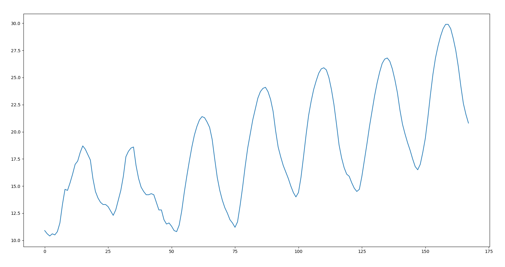
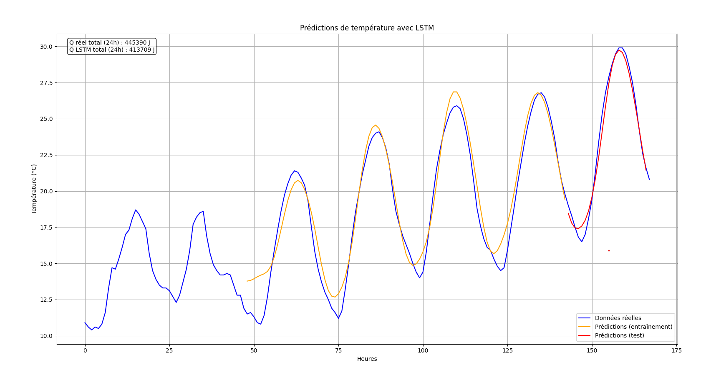
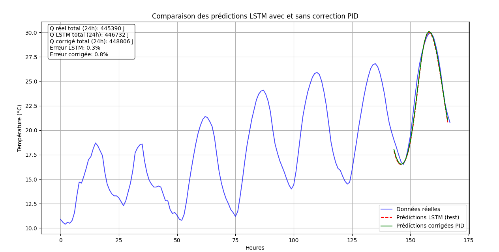

# HVAC Energy Optimization with a Hybrid LSTM + PID Model

*Optimisation énergétique des systèmes CVC par un modèle hybride d'IA*

Forecasting temperature with an LSTM network and correcting it with a PID
controller, to estimate the minimum thermal energy an HVAC system needs over a
24-hour horizon.

> **Context.** This was my TIPE research project, carried out in *classe
> préparatoire* (CPGE) in 2023 under the supervision of M. Ezzahori Hassan.
> The code here is a cleaned-up and reproducible version of the original work;
> the physics, model architecture and results are unchanged. The
> [Limitations](#limitations) section is deliberately detailed — several of the
> methodological choices below would not survive a rigorous review, and saying
> so is more useful than pretending otherwise.

---

## The idea

An HVAC (heating, ventilation and air-conditioning) system is usually driven
*reactively*: it measures the current temperature and responds. If instead you
can **forecast** the temperature over the next 24 hours, you can size the
thermal energy you actually need rather than over-supplying it.

The pipeline:

```
Open-Meteo hourly data
        │
        ▼
  preprocessing  ──  interpolation, IQR filter, min-max scaling
        │
        ▼
   LSTM network  ──  48 h of context → next-hour temperature
        │
        ▼
 PID correction  ──  reduce residual error on the forecast
        │
        ▼
 Q = ṁ · cₚ · |T − T_ref|   →  energy over 24 h
```

### Physics

The thermal energy exchanged is given by the fundamental relation

$$Q = \dot{m} \cdot c_p \cdot |T - T_{ref}|$$

| Symbol | Meaning | Value used |
|---|---|---|
| $\dot{m}$ | mass flow rate | 1 kg/s |
| $c_p$ | specific heat capacity (water) | 4186 J/(kg·K) |
| $T_{ref}$ | comfort setpoint | 22 °C |

The setpoint comes from the overlap of **ASHRAE Standard 55** (20–26 °C) and
**ISO 7730** (22 °C), rather than being chosen arbitrarily.

### Why an LSTM

A plain recurrent network cannot learn the ~24 h periodicity of a daily
temperature cycle: gradients vanish as they are propagated back across that
many timesteps. An LSTM's gated cell state carries information across the span,
which is why it is the right tool here rather than simply the fashionable one.

Architecture:

```
LSTM(100, return_sequences=True) → Dropout(0.2)
LSTM(50)                         → Dropout(0.2)
Dense(25) → Dense(1)
```

Trained with Adam (lr = 1e-3), MSE loss, batch size 16, up to 200 epochs with
early stopping (patience 10). Input window: 48 hours. Test horizon: 24 hours.

---

## Results

Dataset: 168 hourly temperature points (7 days) from the
[Open-Meteo API](https://open-meteo.com/en/docs/metno-api).

**Measured data**



**LSTM predictions**



| Quantity | Value |
|---|---|
| Q real, 24 h | 445 390 J |
| Q predicted (LSTM), 24 h | 413 709 J |
| Difference | ≈ 7.1 % |

**With PID correction**



The PID correction brings the forecast very close to the measured curve over
the test window — see the caveat below on why that result is flattering.

---

## Limitations

These are the things I would fix if I did this project again. They are listed
in full because an honest account of a model's weaknesses is worth more than
an inflated claim.

1. **The ~7 % difference is not a demonstrated energy saving.** The model
   forecasts outdoor temperature from past outdoor temperature. `Q_LSTM <
   Q_real` means the forecast sits slightly *below* the measurement on average
   — that is prediction bias, not a saving. A real saving would require a
   control loop that behaves differently *because of* the forecast, benchmarked
   against a baseline controller.

   This is easy to demonstrate: rerunning the identical pipeline and changing
   only the training length moved the "saving" from **7.7 %** (15 epochs,
   test RMSE 0.74 °C) to **2.3 %** (60 epochs, test RMSE 0.47 °C). A better
   model produced a *smaller* saving — which is the opposite of what a genuine
   efficiency gain would do, and confirms the figure is tracking forecast error
   rather than energy.

2. **The PID correction uses the signal it is meant to predict.** A PID acts on
   a *measured* error. Here it post-corrects a forecast using the gap to the
   actual temperature, which would not be available at inference time in a real
   deployment. This is why the corrected curve in figure 3 tracks the data
   almost perfectly. `src/pid.py` keeps the original behaviour but documents
   the constraint.

3. **Test-set leakage.** The original run passed the test set as
   `validation_data` while early-stopping on `val_loss`, so the test set
   influenced model selection. Reproduced by default for fidelity; use a
   genuine held-out validation split for an honest evaluation.

4. **The test set is one daily cycle (24 points).** Far too small for the RMSE
   to be statistically meaningful.

5. **IQR outlier filtering on a time series** removes genuine temperature
   extremes and breaks the hourly continuity the LSTM depends on. Run with
   `--no-iqr` to skip it.

6. **Univariate model.** Only past temperature is used. Occupancy, solar
   irradiance, humidity and internal gains all drive real HVAC load and are
   ignored.

7. **Simplified assumptions**, stated explicitly in the original study: fixed
   mass flow of 1 kg/s, room volume assumed not to affect the prediction, water
   as the working fluid.

---

## Running it

```bash
git clone https://github.com/<your-username>/hvac-lstm-pid.git
cd hvac-lstm-pid
pip install -r requirements.txt

# 1. download hourly temperature data
python src/fetch_data.py --start 2024-06-10 --end 2024-06-16 \
    --lat 33.70 --lon -7.40 --out data/temperature.csv

# 2. train, correct and evaluate
python src/main.py --data data/temperature.csv --no-iqr
```

Generated plots are written to `outputs/`. The `figures/` directory holds the
published results from the original study and is not overwritten by a rerun.

A rerun will not reproduce the exact numbers above: Open-Meteo serves the
current best estimate for a given window, and training is stochastic. A recent
run on a fresh download gave Train RMSE 0.33 °C, Test RMSE 0.47 °C, and 0.32 °C
after PID correction.

## Repository layout

```
src/
  fetch_data.py     download hourly temperature from Open-Meteo
  preprocessing.py  interpolation, IQR filter, scaling, sliding windows
  model.py          LSTM architecture and training
  pid.py            PID controller and forecast correction
  energy.py         Q = m_dot · cp · |T − T_ref|
  main.py           end-to-end pipeline
figures/            published results from the original study
outputs/            plots generated by a rerun (gitignored)
data/               datasets (gitignored)
```

## References

- ASHRAE Standard 55 — *Thermal Environmental Conditions for Human Occupancy*
- ISO 7730 — *Ergonomics of the thermal environment*
- Open-Meteo API — <https://open-meteo.com/en/docs/metno-api>
- C. Olah, *Understanding LSTM Networks* — <https://colah.github.io/posts/2015-08-Understanding-LSTMs/>
- ADEME — *Les défis de la transition énergétique*

## Author

**Nassim Bakkas** — TIPE, CPGE 2023. Supervisor: M. Ezzahori Hassan.
