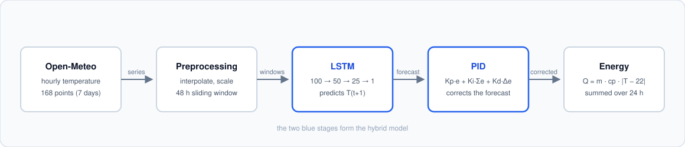
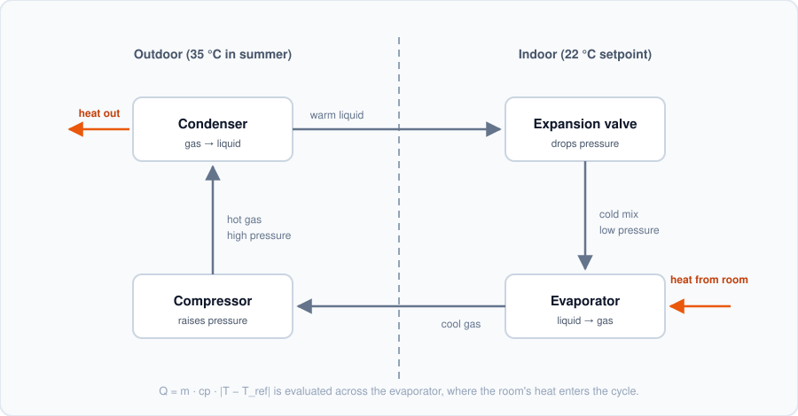
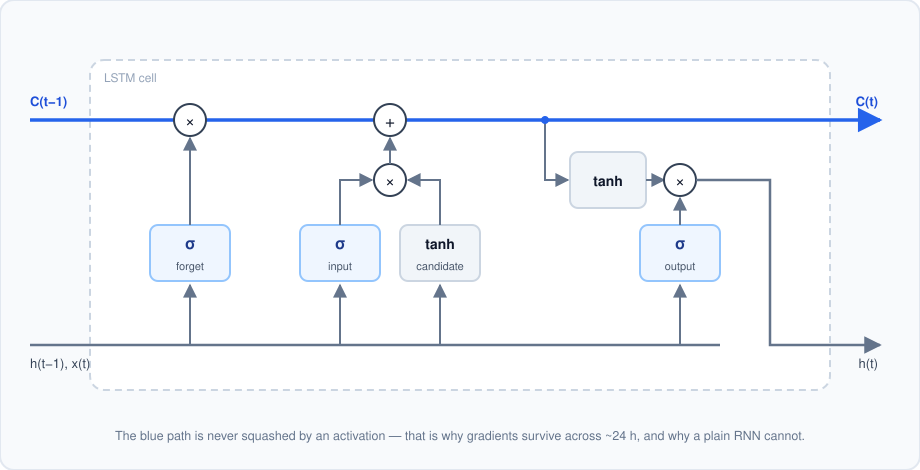
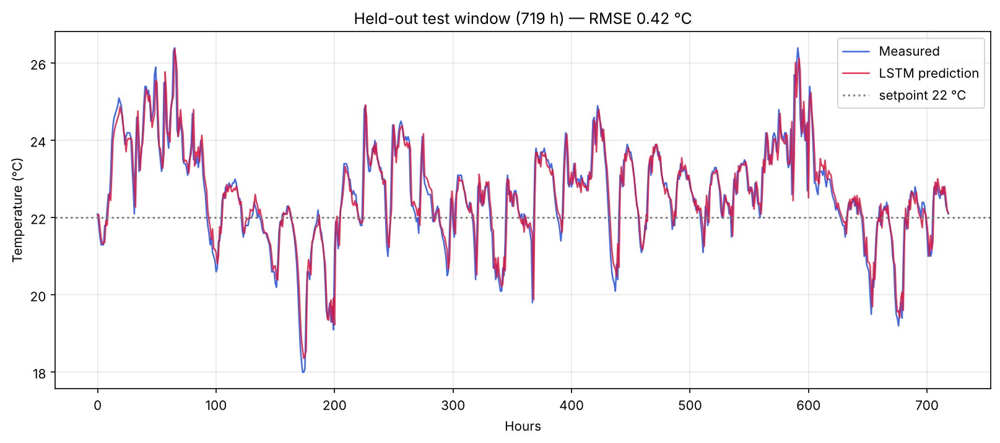
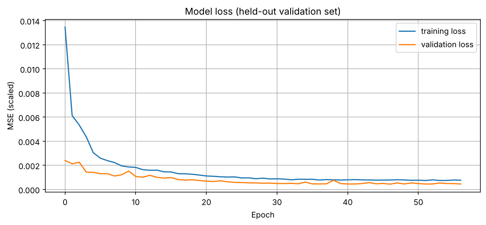

# HVAC Energy Optimization with a Hybrid LSTM + PID Model — A Simulation Study

*Optimisation énergétique des systèmes CVC par un modèle hybride d'IA*

**A simulation study.** Forecasting temperature with an LSTM network and
correcting it with a PID controller, to estimate the minimum thermal energy an
HVAC system needs over a 24-hour horizon.

> **Context.** This was my TIPE study, carried out in *classe préparatoire*
> (CPGE) in 2023 under the supervision of M. Ezzahori Hassan. The code here is
> a cleaned-up and reproducible version of the original work; the physics,
> model architecture and results are unchanged. The
> [Limitations](#limitations) section is deliberately detailed — several of the
> methodological choices below would not survive a rigorous review, and saying
> so is more useful than pretending otherwise.

### Scope

This is an **étude** — a modelling and simulation study, not a built system.
No physical prototype was constructed and no HVAC unit was instrumented.
Specifically:

- The **thermal model** is analytical ($Q = \dot{m} c_p \Delta T$), with a
  fixed mass flow rate and a single lumped temperature.
- The **control electronics** were simulated in [Wokwi](https://wokwi.com/)
  (Arduino UNO + DHT22 sensor + servo damper), never assembled on a bench.
- The **temperature data** is real, but it is outdoor weather from a public
  API — not measurements taken inside a building.
- The **gym case** is an applied numerical scenario used to put the energy
  figures in context, not a monitored installation.

What the study does establish is the modelling chain end to end: physical
relation → data → forecast → control correction → energy estimate.

**Simulated control circuit** (Wokwi): an Arduino UNO reads temperature and
humidity from a DHT22 sensor and drives a servo-actuated damper plus a status
LED. The sketch and Wokwi project live in [`arduino/`](arduino/) — note that
the sketch there is a later reconstruction, as the original was not preserved.


---

## The idea

An HVAC (heating, ventilation and air-conditioning) system is usually driven
*reactively*: it measures the current temperature and responds. If instead you
can **forecast** the temperature over the next 24 hours, you can size the
thermal energy you actually need rather than over-supplying it.

The pipeline:



### Physics

The thermal energy exchanged is given by the fundamental relation

$$Q = \dot{m} \cdot c_p \cdot |T - T_{ref}|$$

| Symbol | Meaning | Value used |
|---|---|---|
| $\dot{m}$ | mass flow rate | 1 kg/s |
| $c_p$ | specific heat capacity (water) | 4186 J/(kg·K) |
| $T_{ref}$ | comfort setpoint | 22 °C |

The setpoint comes from the overlap of **ASHRAE Standard 55** (20–26 °C) and
**ISO 7730** (22 °C), rather than being chosen arbitrarily.

The relation is evaluated across the evaporator, where the room's heat enters
the refrigeration cycle:



### Why an LSTM

A plain recurrent network cannot learn the ~24 h periodicity of a daily
temperature cycle: gradients vanish as they are propagated back across that
many timesteps. An LSTM's gated cell state carries information across the span,
which is why it is the right tool here rather than simply the fashionable one.



The cell state (blue) passes through only a multiplication and an addition — no
squashing activation — so the gradient along it neither vanishes nor explodes.
The three gates decide what to erase, what to write, and what to expose.

Architecture:

```
LSTM(100, return_sequences=True) → Dropout(0.2)
LSTM(50)                         → Dropout(0.2)
Dense(25) → Dense(1)
```

Trained with Adam (lr = 1e-3), MSE loss, batch size 16, up to 200 epochs with
early stopping (patience 10). Input window: 48 hours. Test horizon: 24 hours.

---

## Results

Dataset: 168 hourly temperature points (7 days) from the
[Open-Meteo API](https://open-meteo.com/en/docs/metno-api).

**Measured data**


**LSTM predictions**


| Quantity | Value |
|---|---|
| Q real, 24 h | 445 390 J |
| Q predicted (LSTM), 24 h | 413 709 J |
| Difference | ≈ 7.1 % |

**With PID correction**


The PID correction brings the forecast very close to the measured curve over
the test window — see the caveat below on why that result is flattering.

---

## Extended run — 2026 data

The 7-day dataset above is what the original study used. It is too small to
evaluate a model on, so the pipeline was rerun on **6 792 hourly points**
(1 January – 10 October 2026, Mohammedia), with a methodology that removes
three of the flaws listed below:

| | original run | extended run |
|---|---|---|
| dataset | 168 h (7 days) | 6 792 h (9+ months) |
| split | train / test | train 5 303 · **val 719** · test 719 |
| validation set | *the test set* | separate block |
| scaler fitted on | whole series | **training block only** |
| test horizon | 24 h | 719 h |

Run it with `python src/train_split.py --data data/temperature_2026.csv`.





| metric | value |
|---|---|
| LSTM test RMSE | **0.425 °C** |
| LSTM test MAE | 0.298 °C |
| persistence baseline RMSE | 0.465 °C |

**The persistence baseline matters.** "Tomorrow's hour equals this hour" scores
0.465 °C on the same window. The LSTM reaches 0.425 °C — a real improvement,
but only about 9 %. Reporting it next to the baseline is the difference between
a defensible claim and an inflated one, and the original study never did this.

### What the longer window revealed about the PID

On a 24-hour window the PID correction appeared to help. Over 719 hours, with
the study's original gains, it makes the forecast **worse** — and a gain sweep
isolates why:

| Kp | Ki | Kd | test RMSE |
|---|---|---|---|
| 0.50 | **0.100** | 0.05 | 0.697 °C |
| 0.50 | 0.010 | 0.05 | 0.199 °C |
| 0.50 | **0.000** | 0.05 | 0.193 °C |
| 0.50 | 0.000 | 0.00 | 0.212 °C |
| 0.20 | 0.000 | 0.00 | 0.340 °C |

The integral term is the culprit: with `Ki = 0.1` and no anti-windup, a small
systematic bias accumulates over hundreds of steps until the correction
overshoots badly. Twenty-four steps hid the problem; seven hundred exposed it.
This is exactly why the Arduino sketch in [`arduino/`](arduino/) clamps its
integral term.

Note that the `Ki = 0` rows are *not* evidence of a good forecaster. They look
excellent because the correction is fed the measured temperature — limitation 2
below — so they measure how well the loop tracks a value it was already given.

---

## Limitations

These are the things I would fix if I did this project again. They are listed
in full because an honest account of a model's weaknesses is worth more than
an inflated claim.

1. **The ~7 % difference is not a demonstrated energy saving.** The model
   forecasts outdoor temperature from past outdoor temperature. `Q_LSTM <
   Q_real` means the forecast sits slightly *below* the measurement on average
   — that is prediction bias, not a saving. A real saving would require a
   control loop that behaves differently *because of* the forecast, benchmarked
   against a baseline controller.

   This is easy to demonstrate: rerunning the identical pipeline and changing
   only the training length moved the "saving" from **7.7 %** (15 epochs,
   test RMSE 0.74 °C) to **2.3 %** (60 epochs, test RMSE 0.47 °C). A better
   model produced a *smaller* saving — which is the opposite of what a genuine
   efficiency gain would do, and confirms the figure is tracking forecast error
   rather than energy.

   The extended run makes it starker still: two runs of the *same script, same
   seed, same data* gave savings of **1.95 %** and **3.40 %**, while test RMSE
   barely moved (0.423 vs 0.425 °C). A quantity that swings by 75 % between
   identical runs is noise, not a measurement.

2. **The PID correction uses the signal it is meant to predict.** A PID acts on
   a *measured* error. Here it post-corrects a forecast using the gap to the
   actual temperature, which would not be available at inference time in a real
   deployment. This is why the corrected curve in figure 3 tracks the data
   almost perfectly. `src/pid.py` keeps the original behaviour but documents
   the constraint. The gain sweep above shows the second half of the problem:
   over a long horizon the original gains are not merely flattering, they are
   actively harmful.

3. ~~**Test-set leakage.**~~ **Fixed in the extended run.** The original passed
   the test set as `validation_data` while early-stopping on `val_loss`, so the
   test set influenced model selection. `src/train_split.py` uses a separate
   validation block. `main.py` keeps the old behaviour so the published 7-day
   numbers remain reproducible.

4. ~~**The test set is one daily cycle (24 points).**~~ **Fixed in the extended
   run**, which holds out 719 hours.

5. **IQR outlier filtering on a time series** removes genuine temperature
   extremes and breaks the hourly continuity the LSTM depends on. Run with
   `--no-iqr` to skip it; `train_split.py` does not apply it at all.

6. **Univariate model.** Only past temperature is used. Occupancy, solar
   irradiance, humidity and internal gains all drive real HVAC load and are
   ignored. `fetch_data.py` now also downloads relative humidity and shortwave
   radiation, so extending the model to multivariate input is the obvious next
   step.

7. **Simplified assumptions**, stated explicitly in the original study: fixed
   mass flow of 1 kg/s, room volume assumed not to affect the prediction, water
   as the working fluid.

---

## Running it

```bash
git clone https://github.com/<your-username>/hvac-lstm-pid.git
cd hvac-lstm-pid
pip install -r requirements.txt
```

Reproduce the original 7-day study:

```bash
python src/fetch_data.py --start 2024-06-10 --end 2024-06-16 \
    --out data/temperature.csv
python src/main.py --data data/temperature.csv --no-iqr
```

Run the extended evaluation on 2026 data (also writes an Excel copy):

```bash
python src/fetch_data.py --start 2026-01-01 --end 2026-10-10 --chunk-days 90 \
    --out data/temperature_2026.csv --xlsx data/temperature_2026.xlsx
python src/train_split.py --data data/temperature_2026.csv
```

`fetch_data.py` defaults to Mohammedia (33.686 N, 7.383 W); pass `--lat` and
`--lon` for any other site. Long windows are fetched in chunks with backoff,
since the free tier rate-limits.

Generated plots are written to `outputs/`. The `figures/` directory holds the
published results from the original study and is not overwritten by a rerun.

A rerun will not reproduce the exact numbers above: Open-Meteo serves the
current best estimate for a given window, and training is stochastic. A recent
run on a fresh download gave Train RMSE 0.33 °C, Test RMSE 0.47 °C, and 0.32 °C
after PID correction.

## Repository layout

```
src/
  fetch_data.py     download hourly temperature from Open-Meteo
  preprocessing.py  interpolation, IQR filter, scaling, sliding windows
  model.py          LSTM architecture and training
  pid.py            PID controller and forecast correction
  energy.py         Q = m_dot · cp · |T − T_ref|
  main.py           end-to-end pipeline (reproduces the original 7-day run)
  train_split.py    extended run: train/val/test split, baseline, gain sweep
arduino/
  hvac_control/     Wokwi sketch: DHT22 -> PID -> servo damper (reconstructed)
figures/            result plots from the original study, plus original diagrams
outputs/            plots generated by a rerun (gitignored)
data/               datasets (gitignored)
```

## References

- ASHRAE Standard 55 — *Thermal Environmental Conditions for Human Occupancy*
- ISO 7730 — *Ergonomics of the thermal environment*
- Open-Meteo API — <https://open-meteo.com/en/docs/metno-api>
- C. Olah, *Understanding LSTM Networks* — <https://colah.github.io/posts/2015-08-Understanding-LSTMs/>
- ADEME — *Les défis de la transition énergétique*

## Figures

The result plots (`01`–`03`) are the originals produced by the study. The
diagrams (`diagram_*.svg`) were drawn for this repository — they are original
work, not reproductions of the figures cited above, which are linked rather
than embedded.

## Author

**Nassim Bakkas** — TIPE study, CPGE 2023. Supervisor: M. Ezzahori Hassan.
