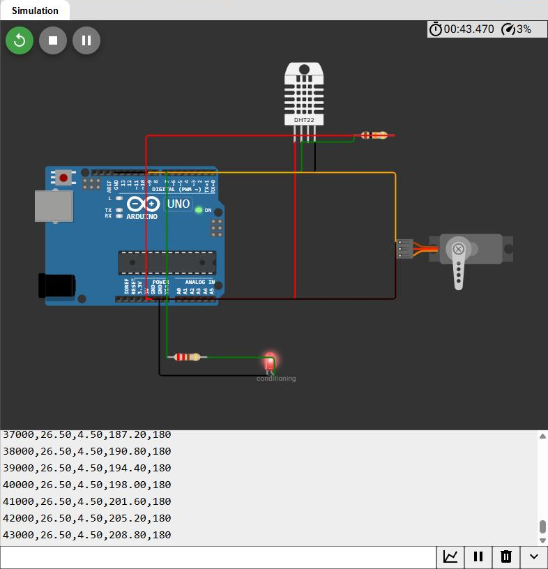
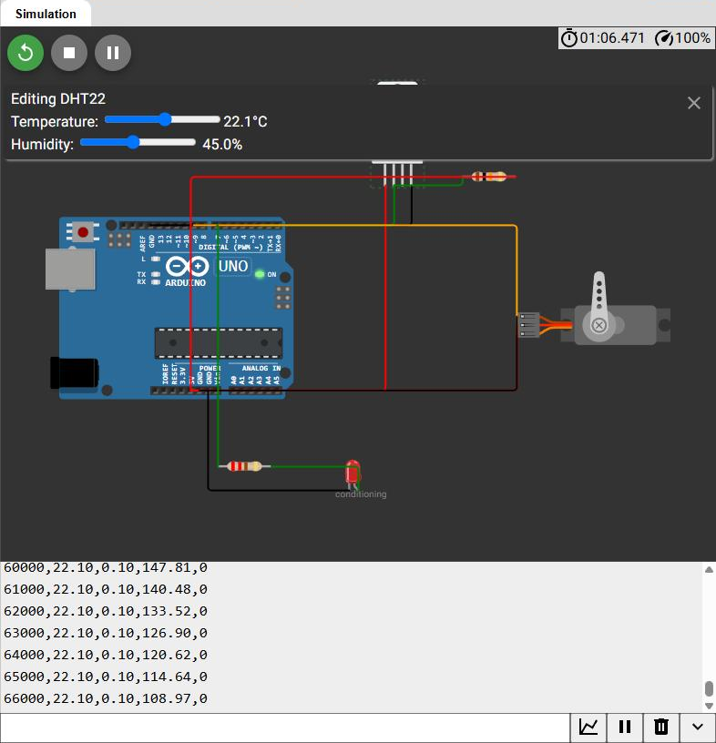

# Simulated control stage (Arduino)

The control half of the study: a DHT22 measures the indoor temperature, a PID
loop compares it to the 22 °C comfort setpoint, and a servo-actuated damper
opens proportionally to the control output. An LED indicates that the system is
actively conditioning.

The circuit as simulated:

## Running in Wokwi

The sketch running in Wokwi with the DHT22 held at 26.5 °C. Reading the
telemetry line `43000,26.50,4.50,208.80,180`:

| field | value | meaning |
|---|---|---|
| `t_ms` | 43000 | 43 s of simulated time |
| `temp_C` | 26.50 | sensor reading |
| `error_C` | 4.50 | 26.5 − 22.0, outside the ±0.3 °C deadband |
| `u` | 208.80 | raw PID output |
| `damper_deg` | 180 | clamped to the actuator's limit |

Two things are visible at once: the **LED is lit** (the loop is conditioning)
and the **servo horn is deflected** to its end stop. The raw output of 208.8°
exceeding the 180° limit is the anti-windup case — the integral term is held at
`(DAMPER_MAX − DAMPER_MIN) / Ki`, so a long saturation cannot accumulate an
output the damper could never deliver. Without that clamp the integral would
keep growing for as long as the error persisted, and the damper would stay
pinned open long after the room had cooled.

This is the same failure that the gain sweep in the main README finds on the
software side, where `Ki = 0.1` with no clamp degrades a 719-hour forecast.

### Inside the deadband

Dropping the sensor to 22.1 °C puts the error at 0.10 °C, within the ±0.3 °C
band:

The **damper returns to 0°**, the **LED goes out**, and the servo horn swings
back. The `u` column is the interesting part — it falls 147.81 → 140.48 →
133.52 → 126.90 → … rather than dropping to zero at once. That is the
`integral *= 0.95` line bleeding the accumulated term off geometrically.

Subtracting the proportional term (`Kp·e = 12 × 0.10 = 1.2`) recovers the
integral itself: 183.26, 174.10, 165.40, 157.12, … Each step is **0.95000 ±
0.00005** of the one before, so the decay the code specifies is directly
measurable in the serial output.

The deadband matters because without it the servo would chatter continuously
around the setpoint on sensor noise, wearing out the actuator for no thermal
benefit.

| Component | Pin | Notes |
|---|---|---|
| DHT22 data | D2 | 10 kΩ pull-up to 5 V |
| Servo (damper) | D9 | PWM-capable pin |
| Status LED | D7 | through 220 Ω to GND |

The PID has the same structure as `src/pid.py`, with two additions the software
version does not need: a **deadband** (±0.3 °C), so the servo does not hunt on
sensor noise around the setpoint, and **integral anti-windup**, so a long
saturation period cannot accumulate an output the damper can never deliver.

In the full hybrid model the LSTM forecast supplies the setpoint schedule. Here
the setpoint is fixed so the control loop can be tested on its own.

## Reproducing it

1. Open a new Arduino UNO project at <https://wokwi.com/projects/new/arduino-uno>.
2. Paste `hvac_control/hvac_control.ino` into `sketch.ino` and
   `hvac_control/diagram.json` into the `diagram.json` tab.
3. In the Library Manager, add **DHT sensor library**. Wokwi pulls in **Servo**
   automatically once the sketch is in place.
4. Press start.

Click the DHT22 in the running simulation to change its temperature: above
22.3 °C the damper opens and the LED lights; back inside the ±0.3 °C deadband
the damper closes and the LED goes out.

The serial monitor prints CSV (`t_ms,temp_C,error_C,u,damper_deg`), so a run can
be captured and plotted alongside the Python results.

Verified with `arduino-cli` 1.3.1 against `arduino:avr:uno`: compiles clean with
`--warnings all` (6 916 bytes flash, 272 bytes RAM).

## Provenance

**This sketch is a reconstruction.** The original 2023 Wokwi project was not
preserved. The code here was written later to match the circuit documented in
the study (`figures/00_wokwi_circuit.png`) and the control strategy described in
it. The circuit image is original; the sketch is a faithful reimplementation,
not the original source.
