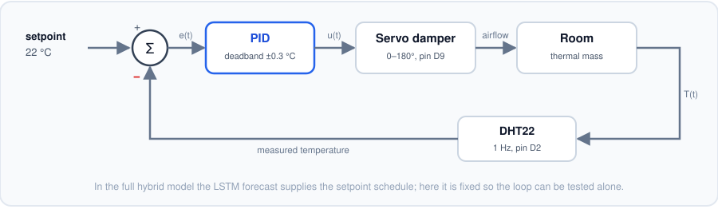
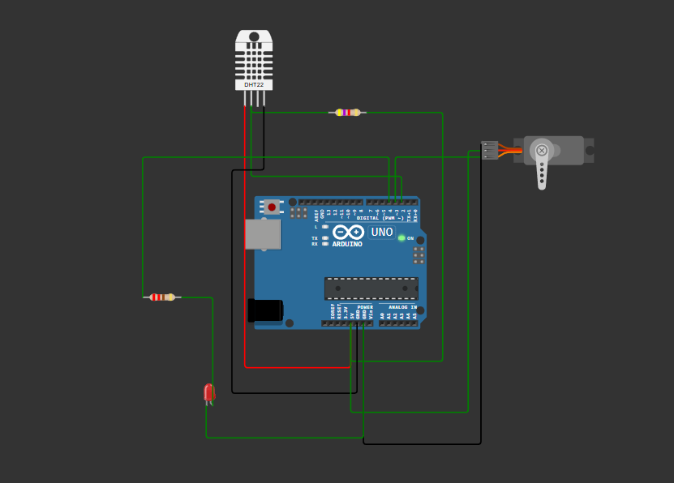

# Simulated control stage (Arduino)

The control half of the study: a DHT22 measures the indoor temperature, a PID
loop compares it to the 22 °C comfort setpoint, and a servo-actuated damper
opens proportionally to the control output. An LED indicates that the system is
actively conditioning.

The circuit as simulated:

| Component | Pin | Notes |
|---|---|---|
| DHT22 data | D2 | 10 kΩ pull-up to 5 V |
| Servo (damper) | D9 | PWM-capable pin |
| Status LED | D7 | through 220 Ω to GND |

The PID has the same structure as `src/pid.py`, with two additions the software
version does not need: a **deadband** (±0.3 °C), so the servo does not hunt on
sensor noise around the setpoint, and **integral anti-windup**, so a long
saturation period cannot accumulate an output the damper can never deliver.

In the full hybrid model the LSTM forecast supplies the setpoint schedule. Here
the setpoint is fixed so the control loop can be tested on its own.

## Running it

The sketch is a Wokwi project. Create a new Arduino UNO project at
<https://wokwi.com/> and replace `sketch.ino`, `diagram.json` and
`libraries.txt` with the files in `hvac_control/`. Raise the DHT22 temperature
above 22 °C in the simulator and the damper opens; drop it back inside the
deadband and the damper closes and the LED goes out.

The serial monitor prints CSV (`t_ms,temp_C,error_C,u,damper_deg`), so a run can
be captured and plotted alongside the Python results.

## Provenance

**This sketch is a reconstruction.** The original 2023 Wokwi project was not
preserved. The code here was written later to match the circuit documented in
the study (`figures/00_wokwi_circuit.png`) and the control strategy described in
it. The circuit image is original; the sketch is a faithful reimplementation,
not the original source.
